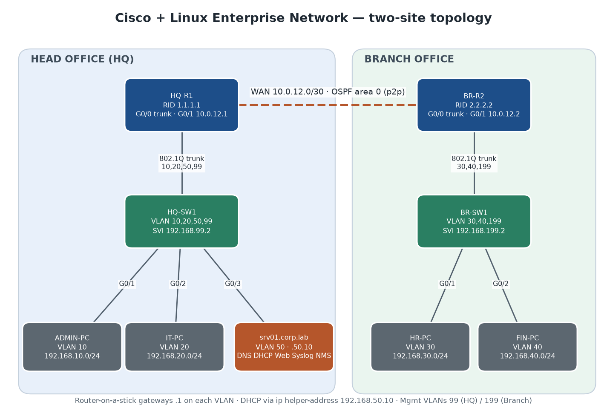
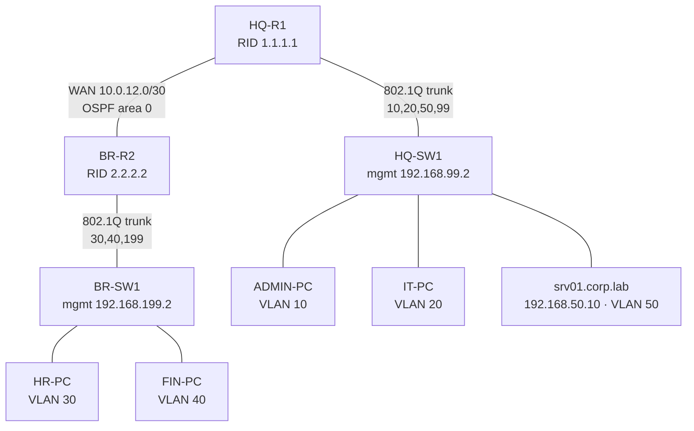

# Enterprise Network Infrastructure — Cisco & Linux

Design, build, secure, automate and monitor a small two-site enterprise network:
Cisco routing and switching, Ubuntu network services, Ansible/Python automation,
SNMPv3 and Syslog monitoring, and test evidence for every requirement.



## Scenario

A company has a **Head Office (HQ)** and one **Branch**. HQ hosts the shared Linux server.
Departments are separated by VLANs, and the sites are joined by a point-to-point WAN running OSPF.

| Success criterion | Where it is shown |
|---|---|
| HQ and branch clients reach permitted remote networks | [T01, T04](testing/results/test-report.md) |
| OSPF adjacency forms and routes are learned dynamically | [T03](testing/results/test-report.md), [cisco/ospf](cisco/ospf/) |
| VLAN segmentation and ACLs enforce access policy | [T07, T08](testing/results/test-report.md), [cisco/security](cisco/security/) |
| Ubuntu provides SSH, web, DNS and DHCP | [T02, T05, T06, T15](testing/results/test-report.md), [linux/](linux/) |
| Ansible backs up configs; Python checks reachability | [T12, T13](testing/results/test-report.md), [automation/](automation/) |
| Monitoring and Syslog record a controlled link event | [T09, T10, T11](testing/results/test-report.md), [monitoring/](monitoring/) |

## Topology and addressing



| Site | VLAN | Name | Subnet | Gateway |
|---|---|---|---|---|
| HQ | 10 | ADMIN | 192.168.10.0/24 | 192.168.10.1 (HQ-R1 G0/0.10) |
| HQ | 20 | IT | 192.168.20.0/24 | 192.168.20.1 (HQ-R1 G0/0.20) |
| HQ | 50 | SERVERS | 192.168.50.0/24 | 192.168.50.1 (HQ-R1 G0/0.50) |
| HQ | 99 | MANAGEMENT | 192.168.99.0/24 | 192.168.99.1 (HQ-R1 G0/0.99) |
| Branch | 30 | HR | 192.168.30.0/24 | 192.168.30.1 (BR-R2 G0/0.30) |
| Branch | 40 | FINANCE | 192.168.40.0/24 | 192.168.40.1 (BR-R2 G0/0.40) |
| Branch | 199 | MANAGEMENT | 192.168.199.0/24 | 192.168.199.1 (BR-R2 G0/0.199) |
| WAN | – | R1–R2 | 10.0.12.0/30 | R1 .1 / R2 .2 |

Reserved: srv01 `192.168.50.10`, HQ-SW1 SVI `192.168.99.2`, BR-SW1 SVI `192.168.199.2`.
Clients get DHCP from Kea through `ip helper-address` (pools `.100–.199`).
Full plan: [topology/addressing-plan.xlsx](topology/addressing-plan.xlsx) · [CSV](topology/addressing-plan.csv).

## Access policy

| From \ To | Admin 10 | IT 20 | Servers 50 | Mgmt 99/199 | HR 30 | Finance 40 |
|---|---|---|---|---|---|---|
| Admin 10 | – | ✅ | ✅ | ✅ | ✅ | ✅ |
| IT 20 | ✅ | – | ✅ | ❌ `MGMT-PROTECT` | ✅ | ❌ `FINANCE-PROTECT` |
| HR 30 | ✅ | ✅ | ✅ | ❌ `MGMT-PROTECT` | – | ❌ `FINANCE-PROTECT` |
| srv01 | ✅ | ✅ | – | ✅ | ✅ | ✅ |

## Repository layout

```
topology/        diagram, addressing plan (xlsx/csv)
cisco/
  routers/       HQ-R1.cfg, BR-R2.cfg       (IOSv / ISR, sanitized)
  switches/      HQ-SW1.cfg, BR-SW1.cfg     (IOSvL2, sanitized)
  ospf/          OSPF design, expected output, WAN-failure procedure
  security/      control matrix, optional guest VLAN 60 + GUEST-FILTER
  packet-tracer/ PT 2911/2960 variants (generated), .pkt topology, notes
linux/
  setup-server.sh  one idempotent script that builds srv01 from this repo
  netplan/ dns/ dhcp/ nginx/ firewall/ syslog/ snmp/
automation/
  ansible/       inventory, vault example, backup + verify-ospf playbooks, sanitizer
  python/        health_check.py (ping + TCP/22 -> CSV + summary), unit tests
monitoring/      SNMPv3, Syslog and LibreNMS notes and evidence
testing/
  emulation/     netns-lab.sh: the topology rebuilt with namespaces + FRR (see below)
  run-tests.sh   guide section 10 test plan, saves evidence
  results/       test-report.md + raw evidence per test
  troubleshooting/  10 troubleshooting challenge records
docs/            build log, limitations, CV entry
```

## How this lab was built

| Layer | Tooling on this PC (Windows 11, 16 GB) |
|---|---|
| Linux server | VirtualBox 7.2 VM `ENL-Ubuntu-Server` — Ubuntu Server 22.04.5, 2 vCPU / 2 GB / 30 GB dynamic disk, unattended install |
| Cisco IOS configs | Cisco Packet Tracer 9.0 (ISR 2911 + Catalyst 2960) — [cisco/packet-tracer](cisco/packet-tracer/) |
| End-to-end routed tests | Namespace emulation on the VM: VLAN-aware bridges, 802.1Q subinterfaces, FRR OSPF, `dhcrelay`, nftables ACLs — [testing/emulation](testing/emulation/) |

**Why emulation as well as Packet Tracer:** GNS3 needs licensed Cisco images, which this
lab does not have, and the guide forbids unofficial copies. Packet Tracer validates the IOS
syntax and behaviour, but it cannot connect to a real Ubuntu VM. The emulation rebuilds the
same design (same names, VLAN tags, subnets, router IDs and ACL logic) in Linux, so the real
Ubuntu services can be tested against routed, relayed, filtered traffic.

### Rebuild it

```bash
# on the Ubuntu VM, from a clone of this repo
sudo ./linux/setup-server.sh              # services, firewall, SNMPv3 user, hardening
sudo ./testing/emulation/netns-lab.sh up  # two-site topology + OSPF + DHCP relay + ACLs
sudo ./testing/run-tests.sh               # runs the test plan, writes testing/results/
```

For real Cisco gear, or for IOSv in GNS3/CML: paste `cisco/*/*.cfg` after replacing the
`<PLACEHOLDER>` secrets, then run the Ansible playbooks with an encrypted `vault.yml`:

```bash
cd automation/ansible
ansible-galaxy collection install cisco.ios ansible.netcommon
ansible-playbook playbooks/backup.yml --ask-vault-pass
ansible-playbook playbooks/verify-ospf.yml --ask-vault-pass
```

## Test results

See **[testing/results/test-report.md](testing/results/test-report.md)** for the latest run,
with raw command output for every test, and
[testing/troubleshooting](testing/troubleshooting/) for the 10 troubleshooting challenges.

## Known limitations

See [docs/limitations.md](docs/limitations.md). In short: no licensed IOS images, so routed
tests run on the Linux emulation and the IOS configs are checked in Packet Tracer (which has no
SNMPv3). Packet Tracer cannot attach to the VM. LibreNMS is documented as an extension, and the
SNMPv3 polling it relies on is tested directly.

## Security of this repository

No IOS images, passwords, private keys, SNMP keys or public IPs are committed. Device configs
use `<PLACEHOLDER>` secrets. Lab secrets are generated on the VM (`/root/lab-secrets.env`, mode 600).
Ansible credentials belong in an encrypted, git-ignored `vault.yml`, and backups are sanitized
before they are stored.
