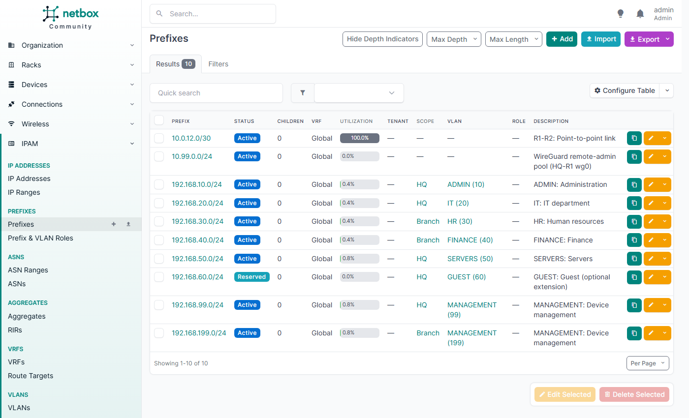
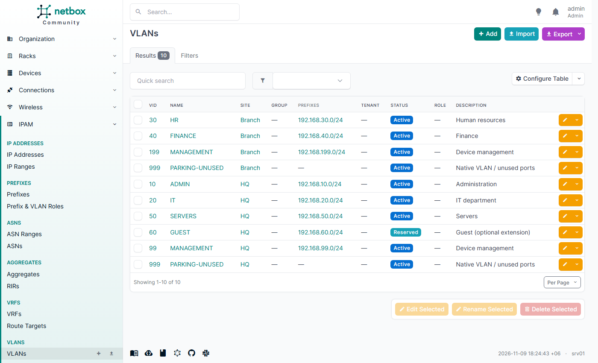
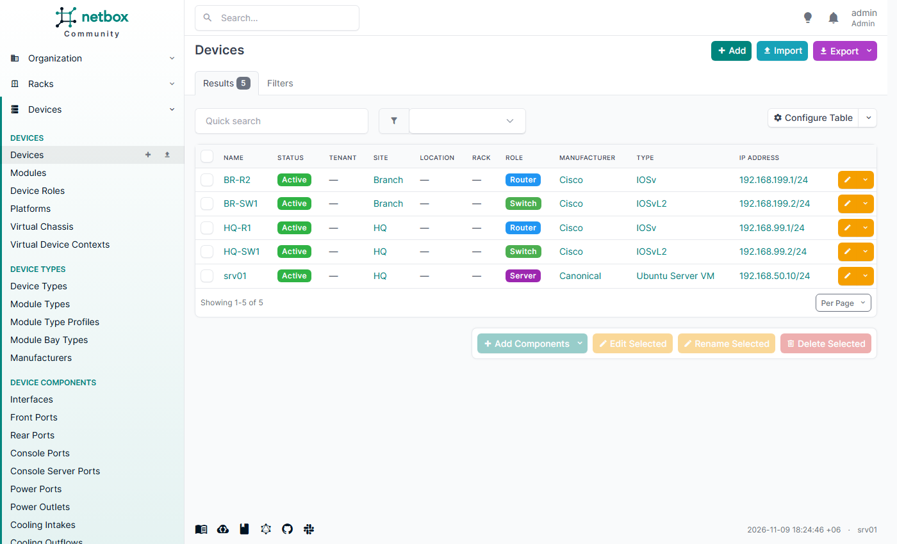
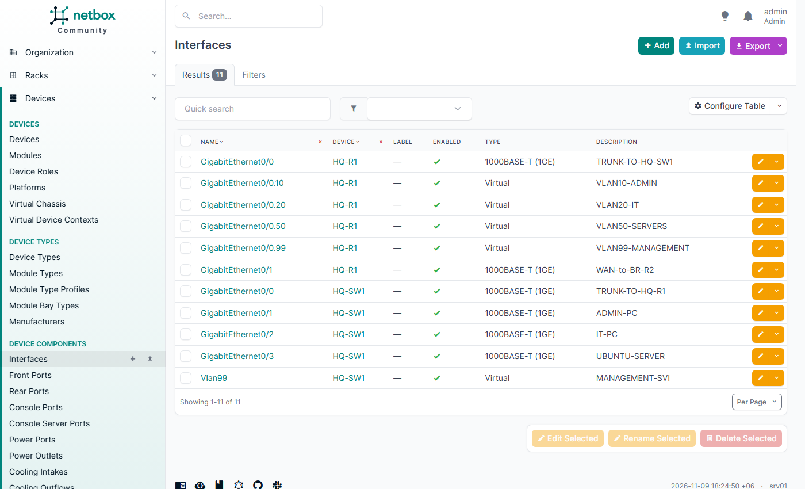

# NetBox: source of truth (IPAM / DCIM)

NetBox documents what the network **should** be. The addressing plan, VLANs, devices,
interfaces, IPs and cables are loaded from this repository through the API. The Nmap audit
(T21) then compares the live network with it.

```bash
sudo ./ipam/netbox/install-netbox.sh      # idempotent; UI http://<srv01>:8082
```

| Part | Detail |
|---|---|
| Version | NetBox **4.7.4**, release tarball, official install guide |
| Python | 3.12 from the deadsnakes PPA. NetBox 4.7 needs ≥ 3.12; Ubuntu 22.04 ships 3.10 |
| PostgreSQL | 17 from the official PGDG repository. NetBox 4.7 needs ≥ 15; Ubuntu 22.04 ships 14. `shared_buffers` 64 MB |
| Redis | 6.0 from Ubuntu: tasks and caching |
| App | gunicorn on 127.0.0.1:8001 (2 workers, 2 threads), `netbox` and `netbox-rq` systemd units |
| Web | Nginx on **8082** ([nginx-netbox.conf](nginx-netbox.conf)); 8082 only from the Admin VLAN, the VPN and the VirtualBox host |
| Secrets | DB password, `SECRET_KEY`, API token pepper and admin password are generated into `/root/lab-secrets.env`. `configuration.py` is root:netbox 640 |

## Import

[import-lab.py](import-lab.py) uses the REST API, stdlib only, and is idempotent: it finds each object, then creates or updates it. Its inputs are [topology/addressing-plan.csv](../../topology/addressing-plan.csv) and the interface layout of the IOS configs.

| Object | Count | Notes |
|---|---|---|
| Sites | 2 | HQ, Branch |
| VLANs | 10 | per site, including 999 PARKING. VLAN 60 is *reserved* |
| Prefixes | 10 | scoped to the site, linked to the VLAN, gateway in the comments. Includes the WAN /30 and the WireGuard pool |
| IP ranges | 4 | the Kea DHCP pools `.100–.199` |
| Devices | 5 | HQ-R1, BR-R2 (IOSv), HQ-SW1, BR-SW1 (IOSvL2), srv01, each with a primary IPv4 and DNS name |
| Interfaces | 21 | router subinterfaces with parents, switch trunks (tagged, native 999), access ports, SVIs |
| IP addresses | 12 | gateways, WAN, switch SVIs, srv01 |
| Cables | 4 | WAN, both trunks, srv01 |

The script provisions a temporary API token from the admin login and deletes it at the end.
NetBox 4.7 v2 tokens (`nbt_…`) require `API_TOKEN_PEPPERS`, which the installer sets.

[nb-expected.py](nb-expected.py) prints every documented IP and DHCP range. The Nmap audit uses it.

## Result (2026-11-09) — test T19

Login page 200. A second import run leaves the counts unchanged, which shows it is idempotent.
[Evidence](../../testing/results/evidence/T19-netbox.txt)

| Prefixes | VLANs | Devices | HQ interfaces |
|---|---|---|---|
|  |  |  |  |
