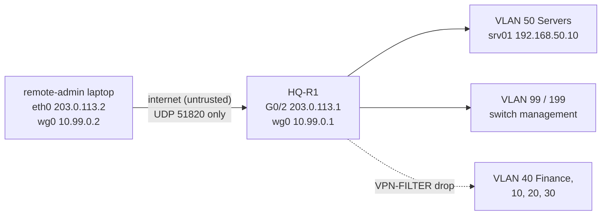

# WireGuard remote lab access (guide section 9, optional)

> "WireGuard (optional) — Secure remote lab access — VPN handshake and permitted route test."

## Design



| Item | Value | Why |
|---|---|---|
| VPN endpoint | HQ-R1 G0/2, UDP 51820 | The edge router terminates the tunnel; srv01 keeps `ip_forward=0` |
| Internet link | 203.0.113.0/30 (TEST-NET-3, RFC 5737) | Documentation range, never routed for real |
| Tunnel pool | 10.99.0.0/24 | Advertised into OSPF as a passive network so BR-R2 can reply |
| Client routes (`AllowedIPs`) | 192.168.50.0/24, 192.168.99.0/24, 192.168.199.0/24 | Least privilege: servers and management only |
| HQ-R1 `EDGE-IN` | G0/2 accepts UDP 51820 only and forwards nothing | Without the tunnel, nothing reaches the LAN |
| HQ-R1 `VPN-FILTER` | wg0 → the three networks above, everything else dropped and logged | Enforced on the router too, so a client that widens its own `AllowedIPs` still cannot reach Finance |
| `MGMT-PROTECT` (both routers) | permit 10.99.0.0/24 | VPN admins manage switches like the Admin VLAN |
| srv01 UFW | SSH, HTTP, DNS, LibreNMS from 10.99.0.0/24 | [linux/firewall/ufw-rules.sh](../firewall/ufw-rules.sh) |
| Keys | generated on the VM in `/etc/wireguard/lab/` (mode 600) | Never committed |

## Build and test

It runs on top of the namespace emulation:

```bash
sudo ./testing/emulation/netns-lab.sh up
sudo ./testing/emulation/wireguard-lab.sh up      # remote-admin namespace, tunnel, filters
sudo ./testing/run-tests.sh                       # T16 = WireGuard
sudo ./testing/emulation/wireguard-lab.sh down
```

T16 checks, in order:

1. **No tunnel:** a route to srv01 via the internet link → dropped by `EDGE-IN`.
2. **Handshake:** `wg show wg0` on HQ-R1 has a recent `latest handshake`.
3. **Permitted routes:** ping srv01, HQ-SW1 (99.2) and BR-SW1 (199.2); TCP/22 and HTTP to srv01.
4. **Not permitted:** Finance (192.168.40.100) has no route on the client.
5. **Defence in depth:** the client adds 192.168.40.0/24 to its own `AllowedIPs` and routes it;
   `VPN-FILTER` on HQ-R1 still drops it (counter shown).

Evidence: [testing/results/evidence/T16-wireguard.txt](../../testing/results/evidence/T16-wireguard.txt).

## On a real deployment

The same client config would be on the admin's laptop (`wg-quick up lab`):

```ini
[Interface]
PrivateKey = <REMOTE_ADMIN_PRIVATE_KEY>
Address    = 10.99.0.2/24
DNS        = 192.168.50.10

[Peer]
PublicKey  = <HQ_R1_PUBLIC_KEY>
Endpoint   = <HQ public address>:51820
AllowedIPs = 192.168.50.0/24, 192.168.99.0/24, 192.168.199.0/24
PersistentKeepalive = 25
```

Cisco IOS has no WireGuard. On Cisco edge gear the same policy would be an IPsec/IKEv2 remote-access
VPN (or AnyConnect on an ASA/FTD), with the `VPN-FILTER` logic as a `vpn-filter` or an inbound ACL on the
virtual-template interface.
