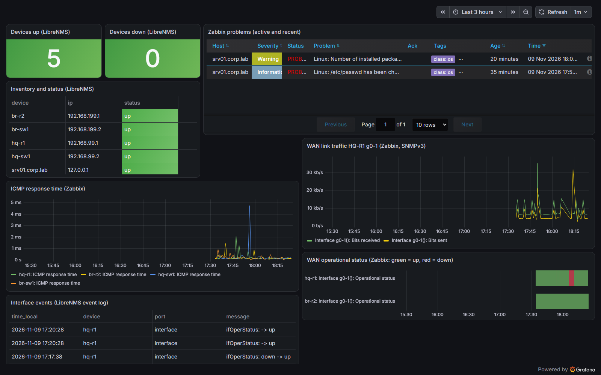

# Grafana on srv01

Grafana OSS shows **Zabbix and LibreNMS on one dashboard**. Data sources, plugin and dashboard
are provisioned from this folder, so a rebuild gives the same result:

```bash
sudo ./monitoring/grafana/install-grafana.sh      # after Zabbix and LibreNMS; UI http://<srv01>:3000
```

| Part | Detail |
|---|---|
| Package | Official `apt.grafana.com` repository |
| Plugin | `alexanderzobnin-zabbix-app`, enabled through [provisioning/plugins](provisioning/plugins/zabbix.yaml) |
| Zabbix data source | API user `grafana`: role allows `*.get` only, read rights on the Lab host groups, no Zabbix UI access |
| LibreNMS data source | MariaDB user `grafana_ro` with `SELECT` on `devices`, `ports` and `eventlog` only |
| Secrets | [datasources/enl.yaml](provisioning/datasources/enl.yaml) holds placeholders; the installer fills them from `/root/lab-secrets.env` into a root:grafana 640 copy |
| Hardening | No sign-up, no anonymous access, no Gravatar, no usage reporting. Port 3000 only from the Admin VLAN, the VPN and the VirtualBox host |

## Dashboard "ENL Lab overview"

[dashboards/enl-lab-overview.json](dashboards/enl-lab-overview.json)

| Panel | Source |
|---|---|
| Devices up/down, inventory table | LibreNMS (SQL) |
| Problems, active and recently resolved | Zabbix |
| ICMP response time, all devices | Zabbix |
| WAN g0-1 traffic and operational status (the red bands are the WAN tests) | Zabbix (SNMPv3) |
| Interface events | LibreNMS event log |



## Result (2026-11-09) — test T20

| Check | Result |
|---|---|
| `/api/health` | database ok |
| Data source health | Zabbix "API version 8.0.0", LibreNMS "Database Connection OK" |
| Dashboard | provisioned, uid `enl-lab-overview` |
| Anonymous request | 401 |

[Evidence](../../testing/results/evidence/T20-grafana.txt)

## Lessons

- **Zabbix 8.0 roles:** the built-in User role has API access off ("No permissions to call hostgroup.get"). Use a dedicated read-only role, not a Super admin token.
- **Zabbix plugin 6.x:** the problems panel type is `alexanderzobnin-zabbix-triggers-panel`, and `showProblems` belongs at the top of the query, not inside `options`.
- **Timezones:** LibreNMS stores local time (Asia/Dhaka). Grafana treats SQL datetimes as UTC, so the event table formats the time as text.
