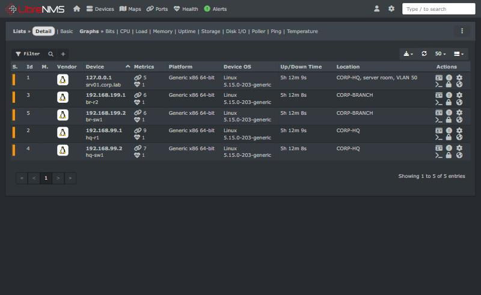
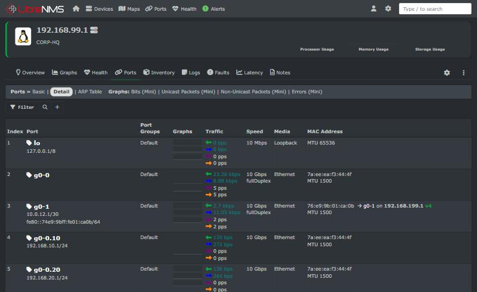
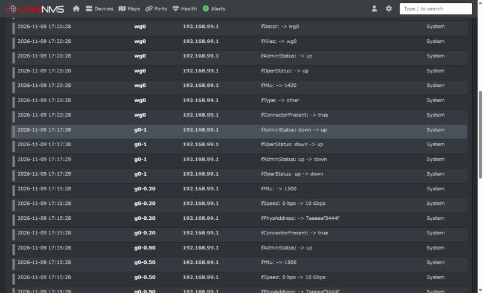

# LibreNMS on srv01

LibreNMS runs on srv01 and polls all five lab devices over **SNMPv3 authPriv** (SHA/AES).
It is installed by one idempotent script that follows the official guide
(https://docs.librenms.org/Installation/Install-LibreNMS/) for Ubuntu 22.04 with Nginx:

```bash
VBoxManage modifyvm ENL-Ubuntu-Server --memory 3072      # LibreNMS + MariaDB need ~1 GB more
sudo ./monitoring/librenms/install-librenms.sh
```

What the script does:

| Stage | Detail |
|---|---|
| Secrets | Generates `LIBRENMS_DB_PASS` and `LIBRENMS_ADMIN_PASS` into `/root/lab-secrets.env` (mode 600) |
| Packages | PHP **8.4** from `ppa:ondrej/php` (current LibreNMS requires PHP ≥ 8.4; Ubuntu 22.04 ships 8.1), MariaDB, rrdtool, fping, Nginx |
| Code | Clones to `/opt/librenms`, `composer install --no-dev`, Python requirements, ACLs on `rrd/ logs/ storage/ bootstrap/cache` |
| Database | `librenms` DB and user, `innodb_file_per_table`, bound to 127.0.0.1 |
| Web | Own PHP-FPM pool (`/run/php-fpm-librenms.sock`) and [nginx-librenms.conf](nginx-librenms.conf) on **port 8000**, so the intranet site keeps port 80 |
| App | `.env`, app key, `lnms migrate`, `db:seed`, admin user, SNMP default `v3` |
| Jobs | cron (poller/discovery wrappers), `librenms-scheduler.timer`, logrotate |
| Firewall | UFW allows 8000/tcp only from the Admin VLAN, the WireGuard pool and the VirtualBox NAT host |
| Devices | Adds srv01, HQ-R1, BR-R2, HQ-SW1, BR-SW1 with the same SNMPv3 user as the test suite |
| Validate | `validate.php` |

Device add (credentials come from `/root/lab-secrets.env`, never the command history of a committed file):

```bash
sudo -u librenms lnms device:add --v3 --security-name=monitor \
  --auth-protocol=SHA --auth-password="$SNMP_AUTH" \
  --privacy-protocol=AES --privacy-password="$SNMP_PRIV" \
  --port-association-mode=ifName 192.168.99.1
```

LibreNMS 26.10+ stores SNMP credentials **encrypted** in its `secrets` table, linked to each device
through `device_polling_methods` (there are no plain-text `authpass` columns any more).

## Result (2026-11-09)

| Check | Result |
|---|---|
| `validate.php` | All OK (database, schema, poller, scheduler, Python wrapper) |
| Devices | 5/5 **up**, SNMP method `snmp-v3`, last check successful |
| Ports discovered | 31 (subinterfaces, SVIs, WAN, `wg0`) |
| WAN event | `ip link set g0-1 down` on HQ-R1 → eventlog `ifOperStatus: up -> down`, then `down -> up` |
| Test | **T17** in [test-report.md](../../testing/results/test-report.md) ([evidence](../../testing/results/evidence/T17-librenms.txt)) |

| Devices (SNMPv3) | HQ-R1 ports | HQ-R1 event log: WAN down/up |
|---|---|---|
|  |  |  |

Open it from the Windows host at <http://127.0.0.1:8000> (VirtualBox NAT forward), user `admin`,
password in `/root/lab-secrets.env` on the VM.

On real Cisco devices the same add command works unchanged against the `snmp-server user monitor
SNMPV3-RO v3 auth sha ... priv aes 128 ...` configured in [cisco/](../../cisco/); LibreNMS then detects
`os=ios` instead of `linux`.
