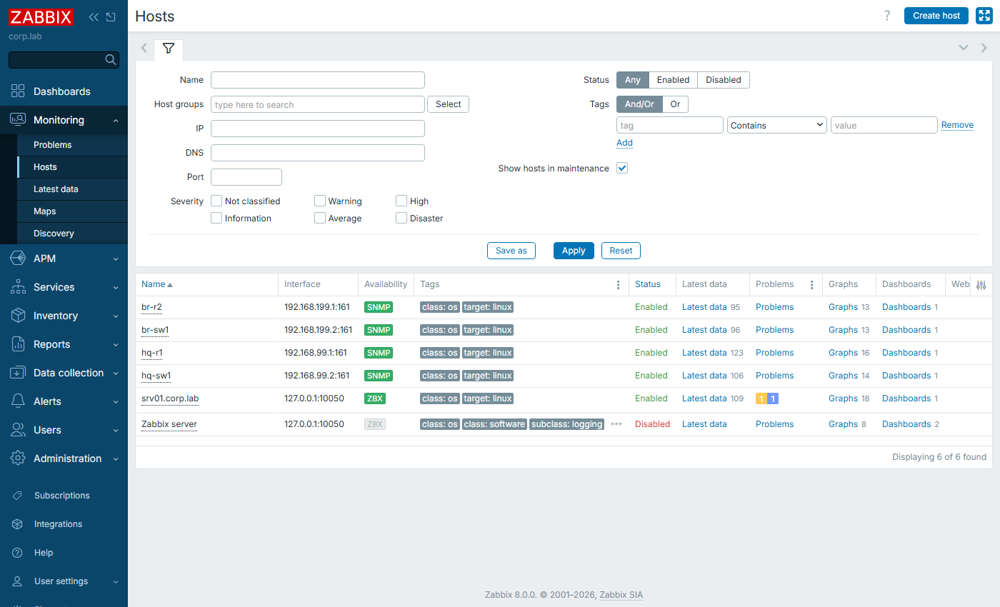
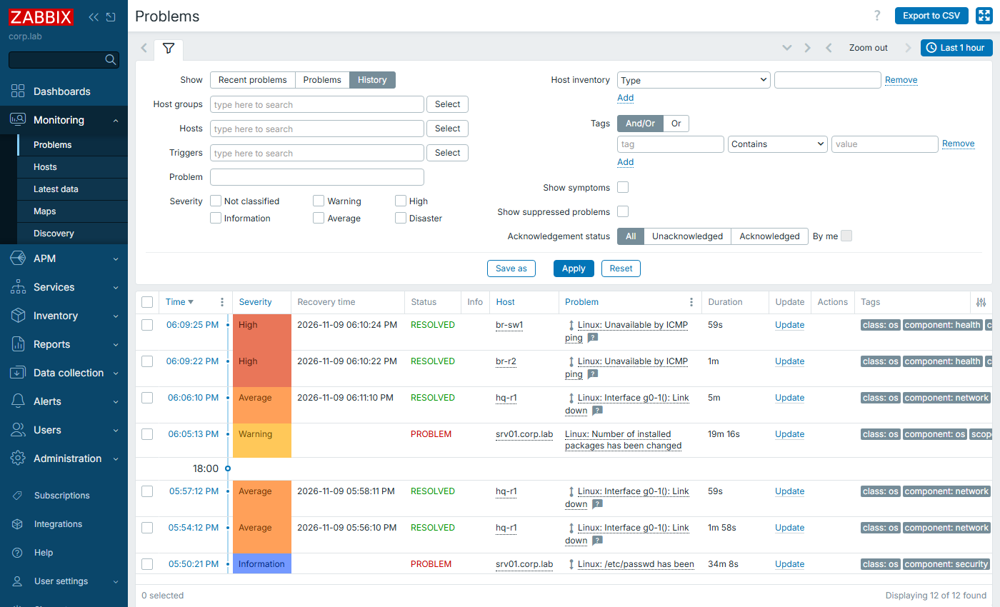
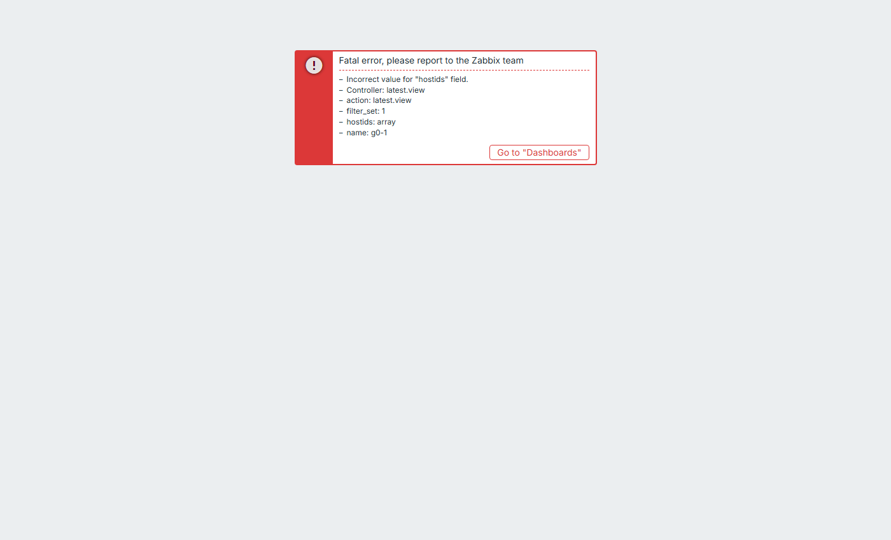

# Zabbix on srv01

Zabbix 8.0 LTS (server, web UI, agent 2) monitors the lab next to LibreNMS. It uses the same
SNMPv3 user as everything else, and keeps the keys out of host settings as **secret macros**.

```bash
sudo ./monitoring/zabbix/install-zabbix.sh      # idempotent; web UI http://<srv01>:8081
```

| Part | Detail |
|---|---|
| Packages | Official `repo.zabbix.com` 8.0 repository: `zabbix-server-mysql`, `zabbix-frontend-php`, `zabbix-nginx-conf`, `zabbix-agent2` |
| PHP | Reuses PHP **8.4** from LibreNMS (`php8.4-*` are installed first, so Zabbix does not pull a second PHP) |
| Database | `zabbix` on the shared MariaDB, `utf8mb4_bin`, schema imported once |
| Server tuning | 5 pollers, 2 pingers, small caches: a 3 GB VM shared with LibreNMS, NetBox and Grafana |
| Web | Nginx on **8081**, `zabbix.conf.php` written by the script (no setup wizard) |
| Firewall | 8081 only from the Admin VLAN, the WireGuard pool and the VirtualBox host |
| Configuration | [zabbix-configure.py](zabbix-configure.py), JSON-RPC API, idempotent (below) |

## What the API script configures

1. Replaces the default `Admin/zabbix` password with a generated one (`/root/lab-secrets.env`).
2. Global macros `{$SNMPV3_USER}`, `{$SNMPV3_AUTH}` and `{$SNMPV3_PRIV}`. The last two are type **secret text**: the API and UI never return their values.
3. Host groups `Lab/Routers`, `Lab/Switches` and `Lab/Servers`.
4. Hosts:

   | Host | Interface | Template |
   |---|---|---|
   | hq-r1, br-r2, hq-sw1, br-sw1 | SNMPv3 authPriv, SHA1/AES128, using the macros above | `Linux by SNMP` (emulation). On real IOS: `Cisco IOS by SNMP` |
   | srv01.corp.lab | Zabbix agent 2 on 127.0.0.1:10050 | `Linux by Zabbix agent` |

5. Runs **Check now** on every discovery rule so interfaces appear at once instead of after an hour.
6. Sets up a Grafana API user (`grafana`). Zabbix 8.0 disables API access in its built-in User and Admin roles, so the script creates a role named `Grafana API read-only`:

   | Setting | Value |
   |---|---|
   | Role type | User |
   | API access | on, allow-list `*.get` only |
   | User group | `Grafana readers` |
   | Host group rights | read on the Lab groups |
   | Frontend access | none |

## Result (2026-11-09) — test T18

| Check | Result |
|---|---|
| Host availability | 4 × SNMPv3 + 1 × agent, all **available** |
| Interfaces discovered | all router/switch ports, including `wg0` on HQ-R1 |
| WAN failure | BR-R2 g0-1 down. On HQ-R1, g0-1 shows admin up, oper down. `Linux: Interface g0-1(): Link down` opens within seconds of a forced poll and **resolves** after restore |

[Evidence](../../testing/results/evidence/T18-zabbix.txt) · helper: [zabbix-check.py](zabbix-check.py)
(`hosts`, `poll`, `problem`)

| Hosts | Problems (WAN link down / resolved) | Latest data g0-1 |
|---|---|---|
|  |  |  |

## Lessons

- **Shutting an interface hides it from monitoring.** `ip link set g0-1 down`, like `shutdown` on IOS, sets ifAdminStatus to down. The template's discovery filter then drops the interface, and Zabbix 8 **disables its items** ("lost resource"). The test now fails the WAN from the far end, like a real cable or provider fault.
- **Interface items are dependent items.** All interface items come from one master item, `SNMP walk network interfaces`, so "Check now" has to target that master. `zabbix-check.py poll` handles this.
- **Zabbix 8.0 requires MariaDB ≥ 10.11.** Ubuntu 22.04 ships 10.6, shared with LibreNMS, so the server runs with `AllowUnsupportedDBVersions=1`. See [limitations](../../docs/limitations.md).
