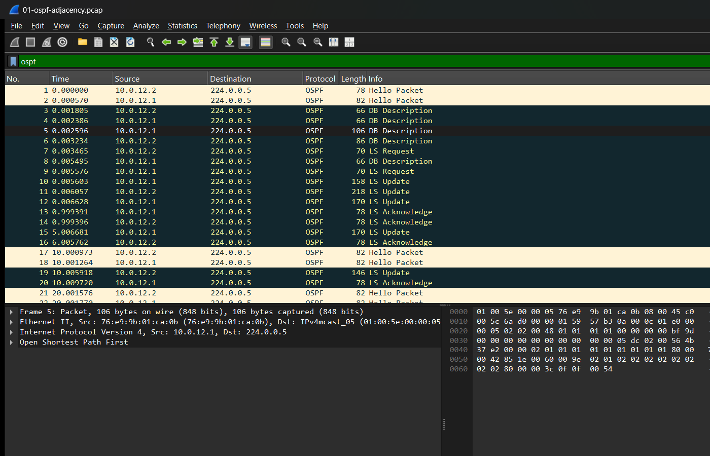
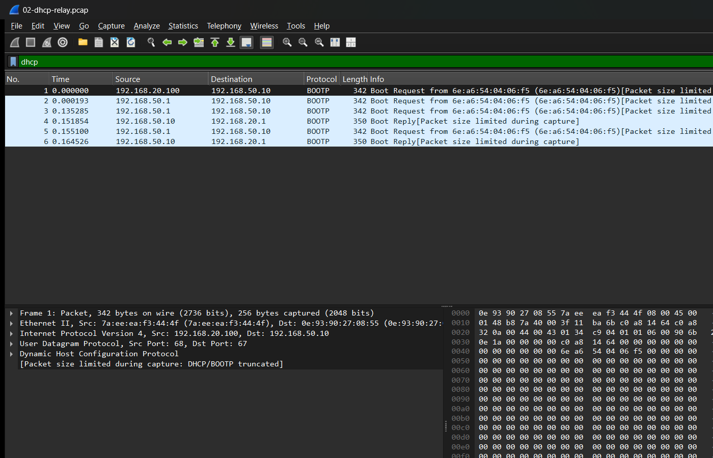
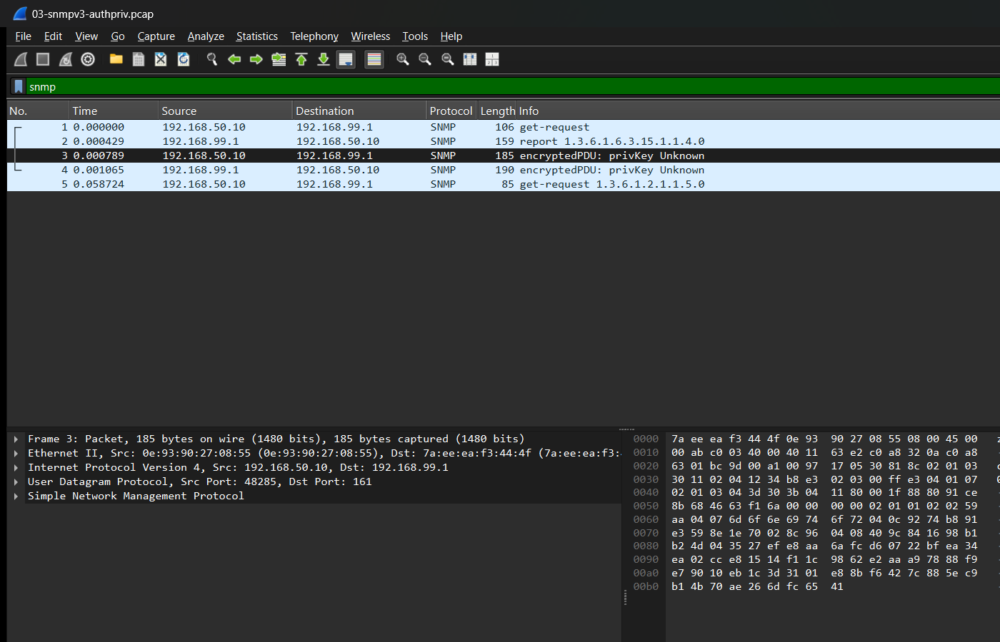
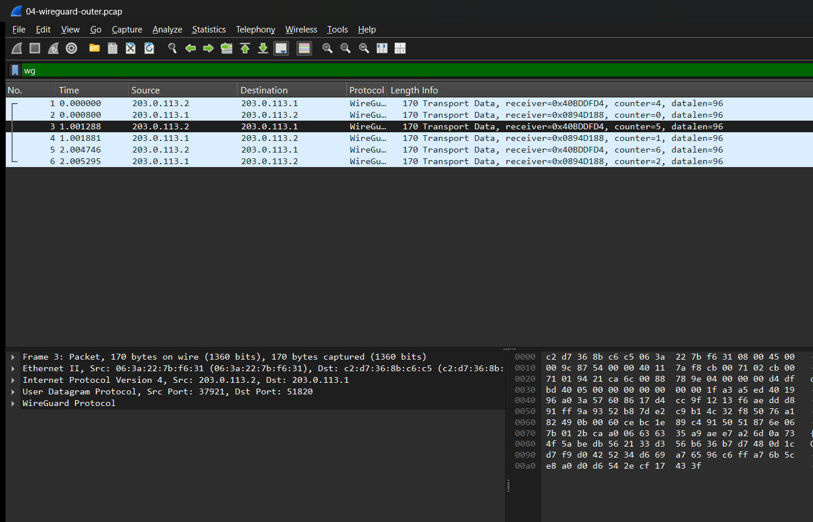

# Packet analysis: tcpdump, tshark and Wireshark

[capture-lab.sh](capture-lab.sh) triggers six real events and captures each one on the
interface where it can be seen. It keeps a `.pcap` for Wireshark and a `tshark` field summary.
It is test T22.

```bash
sudo ./testing/capture/capture-lab.sh       # outputs: testing/results/pcap/
```

| Capture | Where | Event | What it proves |
|---|---|---|---|
| `01-ospf-adjacency` | HQ-R1 g0-1 | BR-R2 WAN flap | OSPF rebuilds the adjacency: Hello, DB Description, LS Request, **LS Update**, LS Ack |
| `02-dhcp-relay` | HQ-R1 g0-0.50 | IT-PC renews | Requests reach Kea **unicast** from the relay, with `giaddr 192.168.20.1`, which selects the IT pool |
| `03-snmpv3-authpriv` | srv01 br-vlan50 | srv01 polls HQ-R1; a v2c `public` attempt | v3 user name visible, **PDU encrypted**, no community string. The v2c request gets no reply |
| `04-wireguard-outer` | HQ-R1 g0-2 (internet) | remote admin pings srv01 | only UDP 51820 "transport data". The ICMP is not visible |
| `05-wireguard-inner` | HQ-R1 wg0 | same ping | the admin's ICMP in clear *inside* the tunnel, after decryption at the edge |
| `06-syslog-plaintext` | srv01 br-vlan50 | IOS-style LINEPROTO message | Syslog over UDP 514 is readable on the wire. This is a known weakness: use TLS/RELP or keep it on the management VLAN |

The pcaps are in [testing/results/pcap/](../results/pcap/). Open them in Wireshark, or read the
`.txt` summaries next to them. The SNMPv3 capture is encrypted with keys that exist only on the VM.

## Wireshark

Wireshark 4.6 on the Windows host opens the same files:

| OSPF adjacency | DHCP relay | SNMPv3 encrypted | WireGuard outer vs inner |
|---|---|---|---|
|  |  |  |  |

Display filters used: `ospf`, `dhcp`, `snmp`, `wg`, `syslog`.
